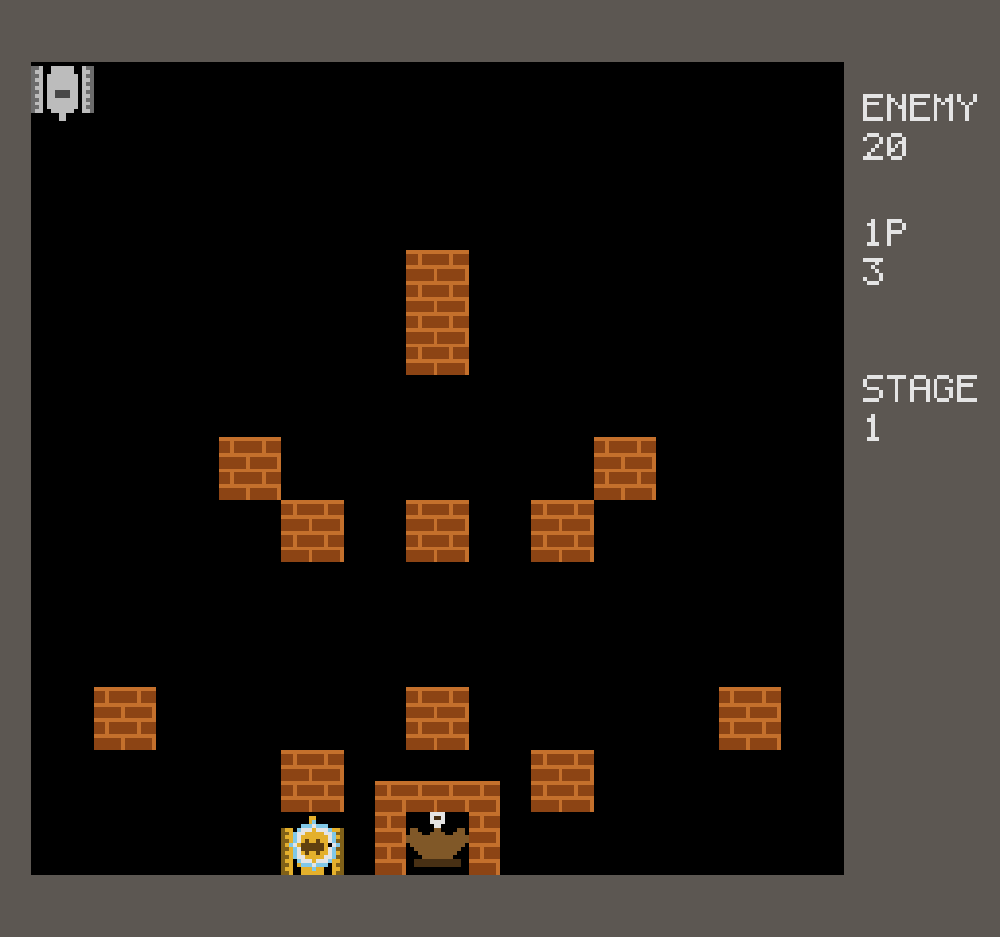
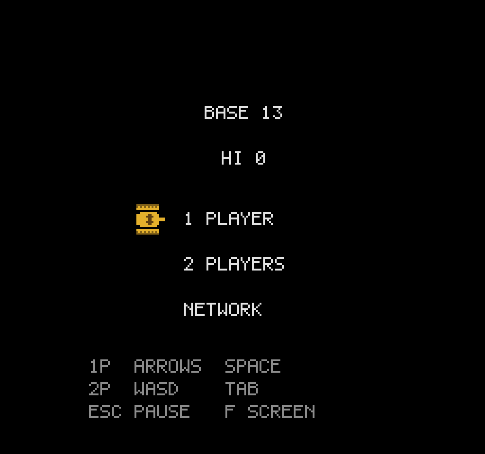

# BASE 13

[](https://github.com/proshik/base13/actions/workflows/ci.yml)


A remake of Battle City — the tank game from the NES — built on Godot.
You defend the eagle at the bottom of the field, chew through brick, grab power-ups,
and keep the enemy away from your base.

<p align="center">
  <a href="https://base13.proshik.ru">
    
  </a>
</p>

<h3 align="center"><a href="https://base13.proshik.ru">▶ Play in the browser</a></h3>

<p align="center">No install: the game runs in a desktop or phone browser, alone or with a partner.</p>

> **Status: playable on desktop and in the browser, two players over the network.**
> Core, rendering, input, a 35-level campaign, NES-chip-style sound, splash screen,
> menu, pause, stats, high score, gamepad, builds for three platforms and the web.
> Two-player co-op: a room by code through our own server, or a direct connection
> on the local network; a dropped connection is survivable — the match catches up
> from the journal.
>
> The room server also serves the game itself, packs into a Docker image and deploys
> with a single command. Next up: mobile platforms and the stores.

## Platforms

| What | State |
|---|---|
| Windows, macOS, Linux | builds, plays |
| Browser | builds, plays |
| Browser on a phone | plays with touch controls; checked on an iPhone in Safari |
| Co-op: quick game, room by code, local network | works |
| Room server and game hosting in one image | works |
| Public server on the internet | runs |
| Android, iOS | subproject 2 |
| App Store, Google Play | subproject 4 |

## How to play

Open [base13.proshik.ru](https://base13.proshik.ru), or run it from the source — see
[Build and run](#build-and-run).

<p align="center">
  
</p>

| | Movement | Fire |
|---|---|---|
| Player 1 | Arrows | Space |
| Player 2 | W A S D | Tab |

Esc pauses; while paused, `Q` exits to the menu and `F` toggles fullscreen. The same
legend is shown at the bottom of the menu. A gamepad works alongside the keyboard: the
d-pad and stick steer, the bottom or right button fires, Start pauses.

At startup the window is fitted to the monitor at an integer scale of 256×240: there is
never any fractional stretching, which would give pixels different sizes. On a
fourteen-inch laptop the window fits triple scale, and fullscreen fits quadruple.

### Two players

The menu has a `NETWORK` entry — the two-player game. Ways to meet:

| Entry | What it does |
|---|---|
| `QUICK GAME` | Pairs you with the first person who pressed the same thing. No code, no address |
| `CREATE ROOM` | Opens a room on the server and shows a six-character code |
| `JOIN ROOM` | Asks for a code and seats you in that room |
| `LAN HOST` | Waits for a partner directly, showing your address on the local network |
| `LAN JOIN` | Asks for the partner's address |

`QUICK GAME` is for playing with a stranger, `CREATE ROOM` with someone specific:
you read the code out loud, and no passer-by will land in that room.

A room works from anywhere: both sides dial out, so there is no port to forward and no
need to be on the same network. All it takes is a running server — see
[docs/room-server.md](docs/room-server.md).

A direct connection (`LAN HOST` / `LAN JOIN`) needs local network permission on macOS 15
and newer, on both machines. How a network match runs, how to read its `[net]` figures
when it stutters, and how to test on two laptops: [docs/network-play.md](docs/network-play.md).

### On a phone

The web build plays in a phone's browser. Held upright, the field sits on top and a
panel below it holds a fixed cross on the left, START in the middle and FIRE on the
right. Turned on its side, the field stands in the middle with the cross in the strip to
its left and FIRE in the strip to its right, START at the top of that strip. START
pauses; the menu offers `1 PLAYER` and `NETWORK`, and in a browser the network screen
has no `LAN` entries. A room waiting for its partner shares itself: FIRE opens the
system's share sheet with a link `https://…/?room=CODE`, and a link like that opens the
join screen with the code filled in — FIRE joins. A code typed by hand goes into the box
under `ROOM CODE`: tap it and the system keyboard comes up. Added to the home screen,
the game starts without the browser's address bar.

## Build and run

You need [Godot 4.7.2](https://godotengine.org/download/archive/); `brew install --cask godot`
installs exactly that version. [`just`](https://github.com/casey/just) is optional: every
task is a script in `tools/`.

```bash
just run          # run the game: godot --path game
just test         # every check: core boundaries, server neutrality, assets, Go, GUT
just build Web    # the web build into build/web; with no argument, all four platforms
just serve        # the room server on this machine, port 27014
```

The details — the editor, export templates, the unsigned macOS build, the web build on a
phone, CI and releases — are in [docs/building.md](docs/building.md).

## Documents

- [Architecture](docs/architecture.md) — what we are building, the deterministic core,
  the repository layout
- [Building, checks and releases](docs/building.md) — tests, builds for every platform,
  the web build on a phone, CI and the release workflow
- [Network play](docs/network-play.md) — how a match runs, the `[net]` lines, the local
  network, testing on two laptops
- [Room server](docs/room-server.md) — running it, the deployment image, the proxy in
  front, metrics and the lag panels
- [Design](docs/specs/2026-08-25-battle-city-core-design.md) — game rules,
  world model, level format, testing strategy
- [Core implementation plan](docs/plans/2026-08-25-battle-city-core-sim.md) —
  17 tasks, TDD
- [Playable-game design](docs/specs/2026-08-27-battle-city-presentation-design.md) —
  rendering, input, campaign
- [Part B1 plan](docs/plans/2026-08-27-battle-city-presentation.md) —
  12 tasks, TDD
- [Part B2 design](docs/specs/2026-08-30-battle-city-shell-design.md) —
  sound, screens, high score, builds
- [Part B2 plan](docs/plans/2026-08-30-battle-city-shell.md) —
  12 tasks, TDD
- [Co-op design](docs/specs/2026-08-31-lockstep-design.md) —
  lockstep, input delay, hash comparison; superseded for network play by the rollback
  design below
- [Rooms and relay design](docs/specs/2026-09-01-platform-design.md) —
  server, room codes, journal and reconnect
- [Quick game and image design](docs/specs/2026-09-03-quick-game-design.md) —
  matchmaking, static hosting, Docker
- [Deployment plan](docs/plans/2026-09-04-deployment.md) —
  the image on a public machine behind a proxy; it runs
- [Network lag plan](docs/plans/2026-09-14-network-lag.md) —
  the adaptive input delay of `0.5.0`, since replaced by rollback
- [Metrics plan](docs/plans/2026-09-14-metrics.md) —
  Prometheus figures, alerts and a dashboard for the room server; shipped in `0.5.0`
- [Rollback design](docs/specs/2026-09-16-rollback-design.md) —
  guessing the partner's keys and stepping back instead of waiting; shipped in `0.6.0`
- [Rollback plan](docs/plans/2026-09-16-rollback.md) —
  9 tasks, TDD
- [Homebrew cask plan](docs/plans/2026-09-04-homebrew-cask.md) —
  installation on macOS in one command; after the deployment
- [Phone browser design](docs/specs/2026-09-28-mobile-web-design.md) —
  touch controls, the upright layout, room links and the home screen
- [Phone browser plan](docs/plans/2026-09-28-mobile-web.md) —
  10 tasks, TDD, and the live checks on an iPhone
- [AGENTS.md](AGENTS.md) — invariants that must not be broken

## Legal

An independent implementation. Battle City is a trademark and a copyrighted work of
Namco/Bandai Namco Entertainment; this project is not affiliated with them and is not
endorsed by them. The graphics, sound and level layouts were created from scratch.

The code and the original assets are released under the MIT License — see
[LICENSE](LICENSE). The bundled GUT test framework in `game/addons/gut` keeps its own
license: [`game/addons/gut/LICENSE.md`](game/addons/gut/LICENSE.md).
